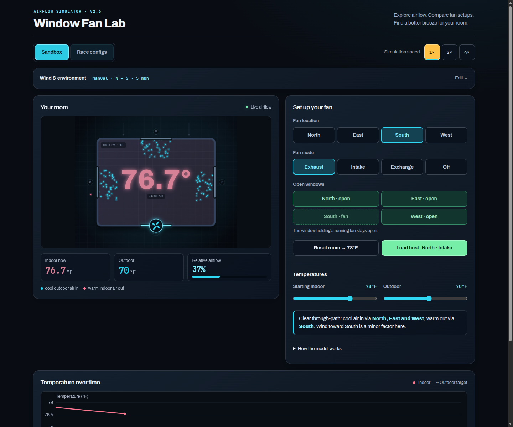
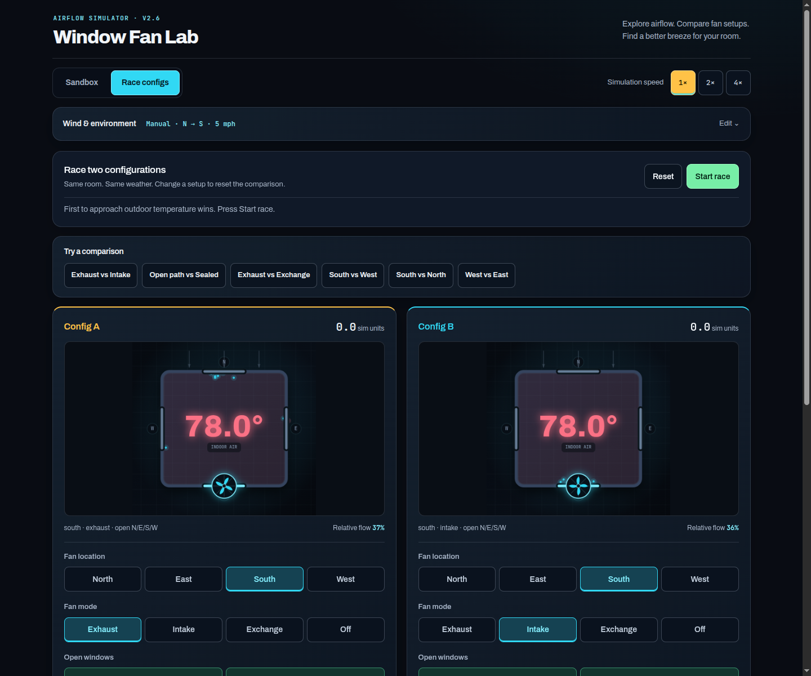

# Window Fan Lab

Window Fan Lab is a single-page browser tool for comparing window-fan setups in a
four-window bedroom. It provides a lightweight airflow simulation, a head-to-head
race mode, and a historical wind rose.

## Screenshots

**Sandbox** — explore one configuration and watch the room cool:



**Race mode** — two configurations head-to-head under the same weather:



## Features

- Explore fan location, fan direction, individual window states, wind direction,
  wind speed, and indoor/outdoor temperature in the sandbox.
- Compare fan placement across North-, East-, South-, and West-facing windows.
- Race two fan configurations under the same conditions.
- Load a historical wind rose for a latitude and longitude using the free
  [Open-Meteo](https://open-meteo.com/) archive API.
- Use one shared wind panel for manual inputs or historical prevailing direction,
  with an explicit FROM → TOWARD conversion and wind speed in mph.
- Show temperatures in °F or °C with the toolbar toggle, which the browser remembers.
  Charts plot temperature against relative simulation time. Relative airflow is a
  percentage of the model reference maximum, not air changes per hour.
- Change race settings to clear its results and start a fresh comparison.

## Run Locally

There is no build step and no package installation.

```bash
cd /path/to/window-fan-lab
python3 -m http.server 8000 --bind 127.0.0.1
```

Then open:

```text
http://localhost:8000
```

The local server is required because the app uses native JavaScript modules. It
also gives the browser a normal web origin for network and geolocation features.

## Tests

The airflow model has a small Node test suite with no package installation.

```bash
node --test
```

## Data And Privacy

- Historical wind data is requested from Open-Meteo for the default Philadelphia
  sample on startup and whenever you submit coordinates. Responses are cached in
  `localStorage` for 24 hours so repeat visits don't refetch.
- Your °F/°C choice is saved in `localStorage`.
- Font files are requested from Google Fonts when the page loads.
- Browser geolocation is used only when you choose the location button.
- The project has no backend.

## Limitations

The airflow model is intended for comparison and intuition. It is not an HVAC
load calculation, a CFD simulation, or a substitute for indoor-air-quality
guidance. It treats the room as a single well-mixed zone. Each open window
feels the wind's pressure on its wall (from the Swami & Chandra low-rise
correlation), and the fan adds a push while partly blocking its own window.
The room settles at the indoor pressure where inflow matches outflow, and
temperature-driven exchange and background leakage are added on top. The
particles follow the resulting flows. Thermal mass and internal heat gains are
not modeled, so rooms always settle at the outdoor temperature.

## Repository Layout

```text
.
├── .github/
│   └── workflows/
│       └── test.yml
├── .gitignore
├── .nojekyll
├── LICENSE
├── README.md
├── index.html
├── styles.css
├── js/
│   ├── app.js
│   ├── charts.js
│   ├── dom.js
│   ├── environment.js
│   ├── history.js
│   ├── draw.js
│   ├── model.js
│   ├── race.js
│   ├── status.js
│   ├── units.js
│   └── wind-rose.js
├── screenshots/
│   ├── race.png
│   └── sandbox.png
└── tests/
    ├── app-contract.test.js
    ├── controllers.test.js
    ├── frontend.test.js
    ├── model.test.js
    ├── status.test.js
    └── units.test.js
```

## GitHub Pages

The `index.html` filename allows GitHub Pages and local web servers to load the
app automatically from the project root. The `.nojekyll` marker keeps the Pages
deployment on the plain static-site path.

## License

Licensed under the [MIT License](LICENSE).
